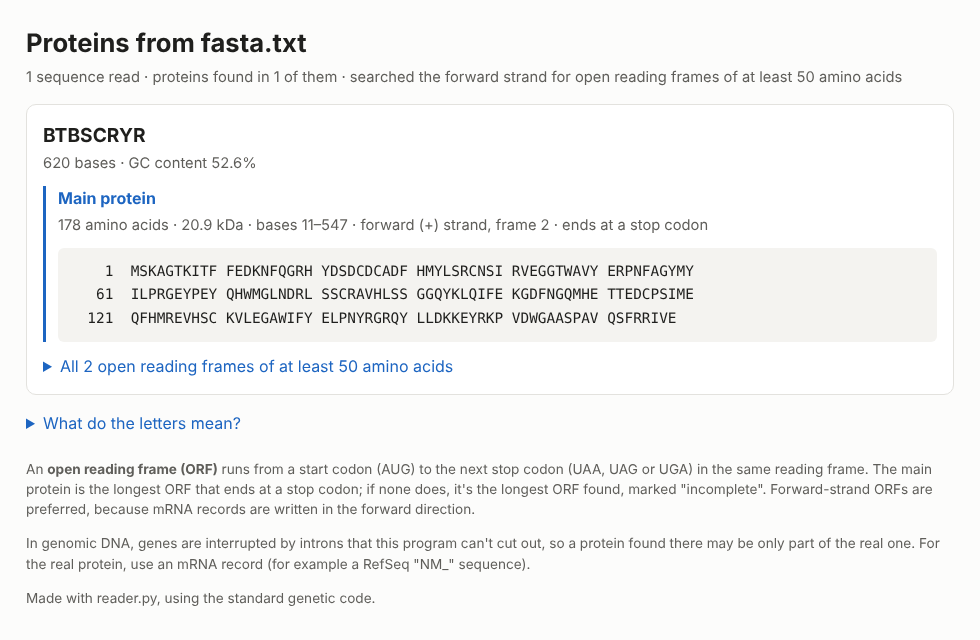

# DNA → protein translator

A command-line Python program that reads DNA (or RNA) sequences from a FASTA file, finds the open reading frames,
translates them into proteins, and saves the results as a web page you can open in any browser.



## What it does

For each sequence in the file, `reader.py`:

1. joins the sequence's lines into one string, so a codon split across a line break stays whole;
2. turns the DNA into mRNA (T becomes U);
3. finds every **open reading frame (ORF)**, a stretch from a start codon (AUG) to the next stop codon
   (UAA, UAG or UGA), in all three reading frames (six with `--both-strands`);
4. translates each ORF with the standard genetic code and picks the **main protein**: the longest ORF that ends at
   a stop codon.

The page shows each record's length and GC content, then its main protein (length, mass in kDa, position) and a
table of every ORF found. `fasta.txt` (one short mRNA record) gives a 178-amino-acid protein from bases 11–547.
See the [example page](example_output/fasta_proteins.html) (download it and open it in a browser) and the
[example protein FASTA](example_output/fasta_proteins.fasta).

## How to run it

You need Python 3 and nothing else (it uses only the standard library). In a terminal, inside this folder:

```bash
python3 reader.py -f fasta.txt
```

This writes `fasta_proteins.html` next to the input file. Open it in your browser.

| Option | What it does |
|---|---|
| `-f FILE`, `--file FILE` | The FASTA file to read (required) |
| `-o PAGE`, `--output PAGE` | Where to save the page (default: the input's name + `_proteins.html`) |
| `--min-length N` | The shortest protein to report, in amino acids (default: 50) |
| `--both-strands` | Also search the opposite strand. Only useful for genomic DNA; ORFs found there may be noise |
| `--fasta FILE` | Also save each record's main protein as a protein FASTA file |

More examples:

```bash
python3 reader.py -f fasta.txt -o my_proteins.html --fasta my_proteins.fasta
python3 reader.py -f humandna.fasta.html --min-length 100 --both-strands
```

## Things to know

- **Use mRNA or cDNA records** (for example RefSeq `NM_` sequences). In genomic DNA, genes are interrupted by
  introns, which this program can't cut out, so a protein found there is often only part of the real one.
  `humandna.fasta.html` (a human keratin gene, genomic DNA) shows this: its 226-amino-acid "main protein" is the
  first exon plus a stretch read into the intron.
- **Ambiguous bases** (N, R, Y and the other IUPAC codes) are handled: a codon such as `GGN` is still glycine,
  and one that could mean different amino acids becomes `X`.
- The translation was checked against [Biopython](https://biopython.org/): the same ORFs and proteins for both
  example files.

## Files

| File | What it is |
|---|---|
| `reader.py` | The program |
| `fasta.txt` | Example input: one mRNA record |
| `humandna.fasta.html` | Example input: a human keratin gene as genomic DNA (a plain-text FASTA file despite its name) |
| `example_output/` | The page and protein FASTA made from `fasta.txt`, and the screenshot above |

## How it grew

The first version (summer 2026) wrote only the file's header line to `codon.txt`. Its translation loop went over
single letters instead of three-letter codons, some checks compared a codon to a whole tuple with `==` instead of
`in`, each line was translated separately (so codons split across lines were lost), and it base-paired the DNA
even though a FASTA mRNA record is already the coding strand. The October 2026 version fixes those bugs and adds
the full genetic code, reading frames, start and stop codons, multi-record files and the HTML page.
