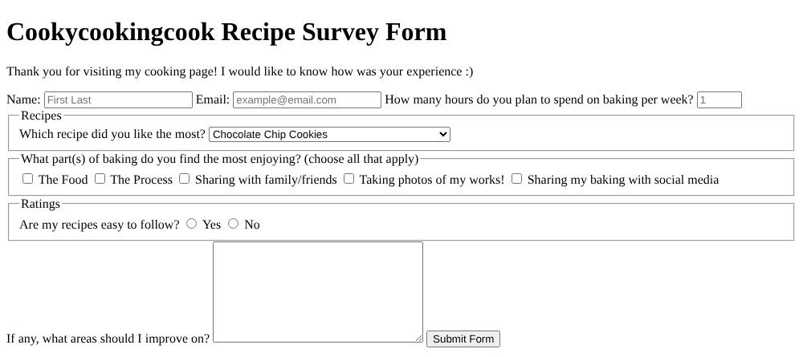

# Survey Form

A survey for a baking page, written in HTML. It's the "Build a Survey Form" project from freeCodeCamp's Responsive
Web Design course.

## What it shows
- Inputs of several types, each with a matching `<label>`: text, email, number, a dropdown, checkboxes, radio
  buttons and a text area.
- Validation built into HTML: name and email are required, the email has to look like an address, and the hours
  must be between 1 and 70.
- `<fieldset>` and `<legend>` to group related questions.

## How to view it
Download `survey.html` and open it in any web browser.
